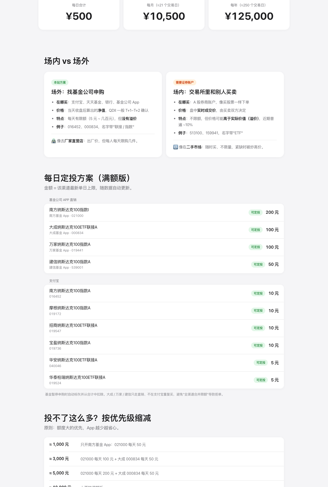

# 📈 纳指场外定投指南

> 支付宝 + 基金公司 App，把纳斯达克100 场外定投额度用满。由 Claude Code 生成。

**🌐 在线访问：[https://climb0516.github.io/nasdaq-dca/](https://climb0516.github.io/nasdaq-dca/)**

⚠️ 仅为公开信息整理，不构成投资建议。

---

## 截图



---

## 内容

- **场内 vs 场外**：两种买法的区别
- **综合评分榜**：用户使用量与信任度（定投人数、自选人数、平均持有天数、份额增长）占 50%，基金属性（跟踪误差、费率、额度、规模）占 50%
- **每日定投方案**：基金公司 App 直销 + 支付宝，满额约 500 元/日，金额随最新限额自动计算
- **按预算缩减**：1000 / 3000 / 5000 / 10000 元每月的配法
- **限额总表**：全部人民币份额纳指100 场外基金，可按"可定投 / 直销更高 / 暂停"筛选
- **A 类 vs C 类、注意事项、场内 ETF 溢价与境外券商现状**

---

## 技术架构

```
GitHub Actions（触发条件：定时 / push / 手动）
  ↓ 运行 scraper.py（仅用 Python 标准库）
  ↓ 遍历 data.json 里已有的 41 只基金，逐只请求天天基金
  ↓   ├─ 移动端接口：申购状态 / 代销限额 / 净值 / 规模 / 用户数据 / 份额
  ↓   └─ 网页解析：管理费 / 托管费 / 跟踪误差
  ↓ 原地改写 data.json（失败的字段保留旧值）
  ↓ 写入心跳 last_update.txt，git commit + push
       ↓
GitHub Pages (index.html)
  ↓ fetch('data.json?t=时间戳') 读取数据
  ↓ 前端计算：每日定投方案金额 / 公司综合评分 / 限额总表筛选排序
  ↓ 详情抽屉（#/item/fund/<代码>、#/item/company/<公司>）+ 列表页（#/list/funds）
```

---

## 数据来源

| 来源 | 方式 | 每次条数 / 范围 | 备注 |
|------|------|----------------|------|
| 天天基金 `FundBaseTypeInformation` | 接口（fundmobapi.eastmoney.com） | data.json 中全部基金（当前 41 只），每只 1 次 | 申购状态原文 `SGZT`、定投状态 `DTZT`、费率 `RATE`、净值 `DWJZ` / `FSRQ`、规模 `ENDNAV` |
| 天天基金 `FundMNUniqueInfo` | 接口 | 每只 1 次 | 自选人数 `FFAVORCOUNT`、近 1 月定投人数 `DTCOUNT_Y`、平均持有天数 `AVGHOLD` |
| 天天基金 `FundMNHolderStructure` | 接口 | 每只 1 次 | 持有人结构（半年报），取最新与往前第 2 期的总份额 `ZFE` |
| 天天基金档案页 `jbgk_<代码>.html` | 网页解析（正则） | 每只 1 次 | 管理费率、托管费率 |
| 天天基金跟踪页 `tsdata_<代码>.html` | 网页解析（正则） | 每只 1 次 | 年化跟踪误差（纳斯达克指数那一项） |
| [安鑫乐 QDII 额度日报](https://anxinletech.com/instrument-qdii.html) | 人工查阅 | — | 基金公司直销单日上限，手动写入 `direct_limit` 和 `direct_updated_at` |

- 接口地址常量在 `scraper.py` 顶部：`API`、`API_USER`、`API_HOLDER`、`PAGE_BASIC`、`PAGE_TRACK`；每次请求前固定休眠 `PAUSE = 0.4` 秒防限流，超时 15 秒，User-Agent 为 `curl/8.7.1`。
- **基金清单不由爬虫发现**：`main()` 只遍历 `data.json` 里的 `funds` 数组。新增基金 = 在 `funds` 里手动加一条（至少填 `code` / `name` / `company` / `share` / `direct_limit` / `direct_only`），下次运行自动补齐其余字段；删除基金 = 直接删掉该条，并检查 `plan` 里是否引用了它。
- 以下内容只能手动维护：

| 字段 | 更新方式 |
|------|----------|
| 直销单日上限 `direct_limit` | 手动改 `data.json`，同时更新 `direct_updated_at` |
| 是否只直销不代销 `direct_only` | 手动改 `data.json` |
| 每日定投方案 `plan` | 手动改 `data.json` |
| 按预算缩减（1000 / 3000 / 5000 / 10000 元） | 写死在 `index.html` 的 `#budget` 区块 |
| 评分权重 | 改 `index.html` 里的 `WEIGHTS` |

---

## 数据处理规则

**限额解析 `parse_sgzt()`**：把天天基金的申购状态原文拆成（状态, 单日上限）

```
'限大额(单日投资上限10元)'      → ('限额', 10)
'限大额(单日投资上限1万元)'     → ('限额', 10000)   # 带「万」乘 10000
'暂停申购(单日投资上限10元)'    → ('暂停', 10)      # main() 里再把 agency_limit 置空
'开放申购'                     → ('开放', None)
```

- 上限用正则 `上限([\d.]+)(万)?元` 提取，整数值去掉小数。
- 状态判断顺序：含「暂停」→ 暂停；含「限」→ 限额；含「开放」→ 开放；都不含则原样保留。
- 暂停申购时接口里的「上限」没有实际意义，`agency_limit` 写 `null`；原文保存在 `status_raw` 供详情抽屉展示。
- `dt_open = (DTZT == "1")`；`size = ENDNAV / 1e8`，保留 1 位小数（亿元）。

**其他字段**

- `update_user()`：自选人数、近 1 月定投人数、平均持有天数，转成数字。
- `update_holder()`：持有人结构按日期 `FSRQ` 倒序，`shares_now` = 第 1 期，`shares_1y_ago` = 第 3 期（两个半年报之前，约一年前），不足 3 期为 `null`。
- `update_fees()`：去 HTML 标签后匹配 `管理费率 x%`、`托管费率 x%`，两者都要匹配到才写入。
- `update_tracking()`：匹配 `同类平均跟踪误差 … 纳斯达克…指数 x%`。

**容错**：每只基金的 4 组附加数据和主接口各自 try/except，失败打印 `[KEEP]` 并保留旧值；只要有 ≥1 只基金主接口成功，才刷新 `updated_at`。

**前端计算（index.html）**

- 每日定投方案 `planAmount()`：`plan` 中 `channel: direct` 取 `direct_limit`，`agency` 取 `agency_limit`；基金暂停时为 0。月合计 = 日合计 × 21，年合计 = 日合计 × 250。
- 综合评分 `companyMetrics()` + `buildRanking()`：按基金公司聚合（代表份额优先取 A 类），8 项指标：

| 维度 | 指标 key | 含义 | 权重 | 变换（越大越好） |
|------|---------|------|------|-----------------|
| 用户 | dt | 近 1 月定投人数（公司各份额求和） | 20 | log1p |
| 用户 | fav | 自选人数（求和） | 10 | log1p |
| 用户 | hold | 平均持有天数（代表份额） | 10 | 原值 |
| 用户 | growth | 近一年份额增长 = 现份额 / 一年前份额 − 1 | 10 | log1p（下限 −0.99） |
| 基金 | te | 跟踪误差 | 15 | 取负 |
| 基金 | fee | 管理费 + 托管费 | 15 | 取负 |
| 基金 | limit | 未暂停份额中 max(直销, 代销) 的最大值 | 12 | log1p |
| 基金 | size | 规模（求和） | 8 | log1p |

  每项在各公司间 min-max 归一到 0–100；缺失值用该项中位数补并标 `*`；全部份额暂停且定投人数为 0 时，dt 按缺失处理。用户分、基金分、总分都是按权重加权平均。`limit = 0` 的公司标记为「买不到」置灰。
- 限额总表筛选 `matches()`：全部 / 可定投（非暂停）/ 直销更高（`direct_limit` > `agency_limit` 或无代销限额）/ 暂停申购；排序 `sortFunds()`：默认（限额与开放在前、暂停在后，同组按限额、规模降序）/ 限额 / 年费率 / 规模 / 评分。首页只显示前 `HOME_N = 10` 只。

---

## 数据结构

`data.json` 顶层：

```
{
  "updated_at": "2026-10-22 12:51",        // 爬虫最后一次成功更新（北京时间）
  "direct_updated_at": "2026-10-08",       // 直销限额人工更新日期
  "plan": [ { "code": "021000", "channel": "direct", "app": "南方基金 App" }, ... ],
  "funds": [ ... ]                          // 当前 41 只
}
```

`funds` 单条：

```
{
  "code": "270042",                 // 基金代码
  "name": "广发纳斯达克100ETF联接A",
  "company": "广发",                // 评分按此聚合
  "share": "A",                     // 份额类别
  "status": "暂停",                 // 限额 / 开放 / 暂停
  "status_raw": "暂停申购(单日投资上限10元)",
  "agency_limit": null,             // 代销单日上限（元），暂停时为 null
  "direct_limit": null,             // 直销单日上限（元），手动维护
  "direct_only": false,             // 是否只在基金公司直销
  "dt_open": false,                 // 是否开放定投
  "rate": "0.13%",                  // 申购费率
  "nav": "8.0701", "nav_date": "2026-10-20",
  "size": 122.2,                    // 规模（亿元）
  "fav_count": 422245.0, "dt_count": 137921.0, "avg_hold": 290.19,
  "shares_now": 1444828288.11, "shares_date": "2026-06-30", "shares_1y_ago": 1381805987.97,
  "mgmt_fee": 0.8, "custody_fee": 0.2,   // 年费率 %
  "tracking_error": 1.02                 // 年化跟踪误差 %
}
```

其他文件：

- `last_update.txt`：心跳文件，内容为 Actions 运行时的北京时间（如 `2026-10-22 12:51:45`），每次运行都会改写。
- `screenshot-desktop.png`：README 截图。
- 无图片 / 快照目录。

---

## 前端

**详情抽屉（通用组件 kit）**：电脑端从右侧滑出，手机端从底部升起；地址写进 hash，分享链接可直接打开对应详情。条目已不在当前数据里（已下榜 / 过期 / 旧链接）时，弹出提示「这条内容已不在当前数据里」。

列表页是新开的一层：从右侧滑入盖在首页上，返回时滑走；首页一直在底下不动，滚动位置不变。在列表里点开的详情盖在这一层之上；直接打开列表链接时不播进场动画；安卓手机可从左边缘右滑返回（iOS 用系统自带手势）。

| 路由 | 内容 |
|------|------|
| `#/item/fund/<基金代码>` | 单只基金：申购限额（代销 / 直销 / 定投 / 申购费率 + 天天基金原文）、费用与规模、净值与份额、用户数据、是否在每日方案中、所属公司评分表、同公司其它份额，按钮跳天天基金页 |
| `#/item/company/<公司名>` | 基金公司：综合评分名次、8 项指标得分与权重、旗下全部份额 |
| `#/list/funds?f=<筛选>&sort=<排序>` | 限额总表完整列表页（每页 `LPAGE = 30` 条，可加载更多），`f` 取 `open` / `direct` / `paused`，`sort` 取 `limit` / `fee` / `size` / `score` |

**本项目特有功能**

- 每日定投方案按最新限额自动计算日 / 月 / 年合计，买不到的行置灰。
- 综合评分榜按公司排名，展示用户分、基金分、总分，缺失项标注。
- 限额总表 4 个筛选 + 5 种排序，首页 10 条，其余进列表页。
- 页头显示 `updated_at`（限额更新时间）和 `direct_updated_at`（直销限额手动更新日期）。

---

## 本地运行

```
cd nasdaq-dca
python3 scraper.py          # 只用标准库，无需 pip install；会原地改写 data.json
python3 -m http.server 8000 # 打开 http://localhost:8000
```

- 依赖：Python 3（CI 用 3.12），无第三方包。
- 环境变量：无。

---

## 自动更新机制

工作流：`.github/workflows/update.yml`（Daily Limit Update）

| 触发方式 | 时机 |
|---------|------|
| GitHub Actions 定时任务 | 每天 09:00 北京时间（cron `0 1 * * *`，UTC 01:00） |
| 任意 push 到 main 分支 | 推送后立即运行 |
| GitHub Actions 手动 dispatch | 按需触发 |

- **心跳**：每次运行都把北京时间写入 `last_update.txt` 并提交。数据有变化时提交信息为「chore: 更新基金限额数据」，无变化时为「chore: update heartbeat <时间>」。这样仓库每天都有提交，避免 GitHub 在仓库 60 天无提交后自动停用定时任务（若已被停用，需在 Actions 页面重新启用）。
- `data.json` 的 `updated_at` 只在至少一只基金主接口成功时刷新，可用来判断数据是否真的更新。
- 接口失败时保留旧数据，不会清空页面。
