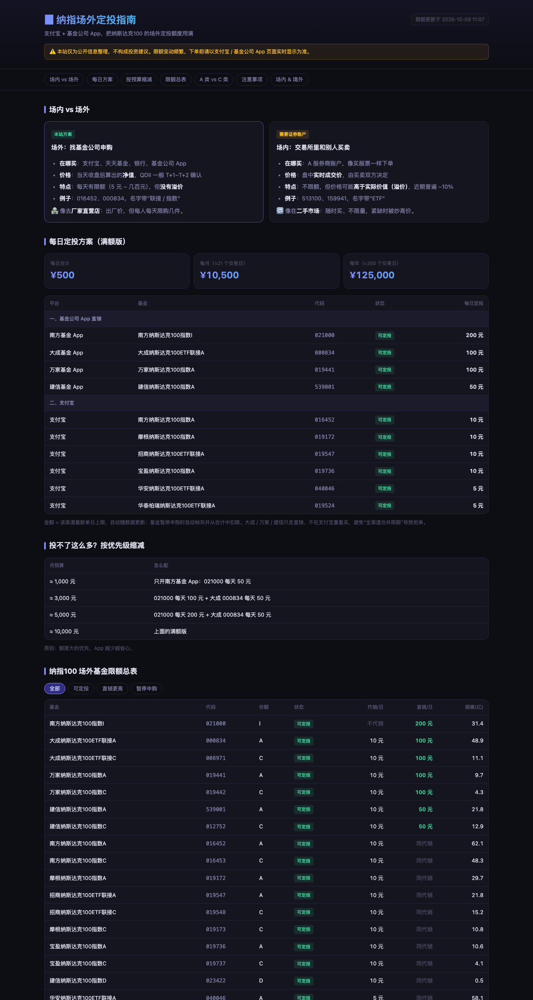

# 📈 纳指场外定投指南

> 支付宝 + 基金公司 App，把纳斯达克100 场外定投额度用满。由 Claude Code 生成。

**🌐 在线访问：[https://climb0516.github.io/nasdaq-dca/](https://climb0516.github.io/nasdaq-dca/)**

⚠️ 仅为公开信息整理，不构成投资建议。

---

## 截图



---

## 内容

- **场内 vs 场外**：两种买法的区别
- **每日定投方案**：基金公司 App 直销 + 支付宝，满额约 500 元/日，金额随最新限额自动计算
- **按预算缩减**：1000 / 3000 / 5000 / 10000 元每月的配法
- **限额总表**：全部人民币份额纳指100 场外基金，可按"可定投 / 直销更高 / 暂停"筛选
- **A 类 vs C 类、注意事项、场内 ETF 溢价与境外券商现状**

---

## 技术架构

```
GitHub Actions（每天 09:00 北京时间 / push / 手动）
  ↓ 运行 scraper.py
  ↓ 请求天天基金接口，更新申购状态与代销单日上限
  ↓ 提交 data.json
       ↓
GitHub Pages (index.html)
  ↓ 前端读取 data.json 渲染
```

---

## 数据维护

| 字段 | 来源 | 更新方式 |
|------|------|----------|
| 申购状态 / 代销单日上限 / 规模 | 天天基金 | 自动，每日 |
| 直销单日上限 `direct_limit` | [安鑫乐 QDII 额度日报](https://anxinletech.com/instrument-qdii.html) | 手动改 `data.json`，同时更新 `direct_updated_at` |
| 定投方案 `plan` | — | 手动改 `data.json` |

接口失败时 scraper 保留旧数据，不会清空页面。

本地运行：

```
python3 scraper.py
python3 -m http.server 8000
```
